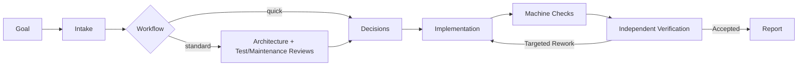
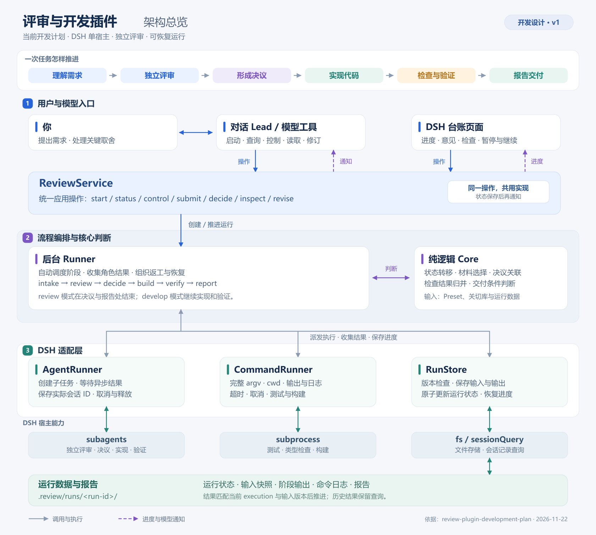

# DSH Team Board

[简体中文](README.md) | **English**

> [!IMPORTANT]
> **Describe your goal with confidence. Let AI work through it with care.**
>
> I built Team Board so you can focus on what you want to achieve. AI should understand the requirements, think through the design, and do the work of implementation and verification properly, producing code that people can understand, change, and keep maintaining.
>
> You set the goal and make the key trade-offs. Let AI shoulder more of the planning, coordination, and checking along the way.

[](https://github.com/teh1592/dsh-team-board/actions/workflows/ci.yml)
[](LICENSE)

A review and development plugin for **DeepSeek Harness (DSH)**. Team Board connects requirements, independent reviews, decisions, implementation, machine checks, and targeted rework in a workflow you can resume.

The Team Board tab provides a run management panel. Stage outputs, changes, check results, and logs are saved in the project so you can follow progress, understand decisions, and continue after an interruption. The panel, user commands, and model tools share the same service.

## Features

- **Two task modes:** `review` produces reviews and implementation decisions; `develop` continues through implementation, checks, independent verification, and rework.
- **Two workflows:** `quick@2` skips the initial pair of reviews; `standard@2` runs independent architecture and test/maintenance reviews.
- **Resumable execution:** pause at a stage boundary, stop immediately, resume, retry, or cancel. Interrupted and superseded results remain available.
- **Real machine checks:** run project-defined commands and record exit codes, test counts, logs, and code fingerprints. Detect checks made stale by changes.
- **Targeted rework and revisions:** preserve finding IDs during verification and redo affected tasks using an impact list.
- **Run management:** inspect role executions, findings, decisions, tasks, checks, reports, and paginated logs, and answer questions that need your input.
- **Run history:** preserve requirement versions, questions, decisions, checks, and reports for on-demand review.



`review` mode ends with decisions and a report. The implementation and verification steps in this diagram run in `develop` mode.

## Architecture



This design diagram uses Chinese labels. The [English architecture guide](docs/en/architecture.md) explains the modules and state rules. The quick workflow skips the initial independent reviews shown in the diagram.

## Requirements

- DeepSeek Harness: verified with **0.2.2-rc.1**.
- Node.js: version 22 or newer. Host integration was verified with **24.22.3**.
- New review runs require DSH Agent, filesystem, working-directory, and subagents services, with at least one fresh-context provider. The official `spawn` provider is recommended. Implementation checks also need subprocess support.
- Session querying supports recovery of interrupted child results.
- Model configuration comes from DSH. This repository contains no model accounts or API keys.

Turn on the Team Board switch after installation. See [dependencies and setup](docs/en/dependencies.md) for the minimum environment and setup steps.

## Installation

### Install a release

1. Follow the [dependency guide](docs/en/dependencies.md) to enable subagents and `spawn`, plus command execution for development tasks.
2. Download `local-team-board-0.5.1-rc.2.tgz` from the [v0.5.1-rc.2 prerelease](https://github.com/teh1592/dsh-team-board/releases/tag/v0.5.1-rc.2).
3. In DSH, ask the plugin manager to run `install_bundle`, using the absolute local archive path as `target`. You can also use the Plugin Manager installation interface.
4. Confirm the result is `application: applied` and review any warnings.
5. Open the Team Board conversation tab, enable the plugin switch, and use the review and development panel.

Example request to DSH:

```text
Install C:/Downloads/local-team-board-0.5.1-rc.2.tgz using plugin_manager and check the installation result.
```

The plugin switch starts off. You choose when to enable it.

### Install from source

```bash
git clone https://github.com/teh1592/dsh-team-board.git
cd dsh-team-board
npm ci --ignore-scripts
npm run build:client
```

Then use DSH's `plugin_manager` to install the absolute path of this directory. `private: true` in the manifest prevents accidental npm publication; it does not prevent GitHub publication or local installation.

## Getting started

Create or select a task in the Team Board header. Overview shows current work and pending choices, Discussion presents findings and decisions, Tasks shows implementation and dependencies, and Results presents checks and reports. Use New requirement to enter requirements, select a workflow, and start. A model can also call `review_start`:

```json
{
  "requestId": "add-pagination-001",
  "requirement": "Add pagination to the list endpoint, preserve existing behavior, and cover edge cases with tests.",
  "preset": "quick@2",
  "mode": "develop"
}
```

Reuse `requestId` when retrying the same start request. Use the returned `runId` for subsequent reads and controls.

| Tool | Purpose |
|---|---|
| `review_start` | Start a review or development run |
| `review_status` | Read current status and next actions |
| `review_read` | Page through findings, decisions, checks, reports, logs, and usage |
| `review_control` | Pause, stop, resume, retry, or cancel |
| `review_revise` | Revise requirements and redo work using an impact list |

User commands are also available:

```text
/review start Add pagination to the list endpoint, preserve compatibility, and define acceptance criteria
/review status <runId>
/review read <runId> report
/review pause <runId>
/review resume <runId>
```

The shorthand `/review start` command defaults to `review` mode. See the [operations guide](docs/en/operations.md) for `develop`, check configuration, and structured commands. Decisions that require your choice are submitted through the panel or user commands; model tools do not make that choice on your behalf.

## Configure machine checks

Create `.review/config.json` in the project being modified:

```json
{
  "schemaVersion": 1,
  "checks": [{
    "id": "node-tests",
    "kind": "test",
    "phase": "implementation",
    "required": true,
    "argv": ["node", "--test", "--test-reporter", "tap", "test/**/*.test.mjs"],
    "cwd": ".",
    "timeoutMs": 180000,
    "parser": "node-test"
  }],
  "maxReworks": 2
}
```

Adjust `argv` to the actual project command. `develop` mode needs configured checks; when none are available, it pauses and explains why. Run data is saved under the project's `.review/runs/` directory, which should remain ignored by Git.

## Development and tests

```bash
npm ci --ignore-scripts
npm test
npm run typecheck
npm run build:client
npm run validate-package
npm pack --ignore-scripts
```

The test script enumerates files to avoid platform differences in directory handling and shell glob expansion. After changing Client components or the view model, regenerate and commit `client.js`.

Before publication, the product suite passed **1591/1591** tests. Real DSH integration covered commands, session indexing, pagination, revision conflicts, cancellation cleanup, and installed interfaces. A separate 15-task pilot passed 14 cases. See the [pilot results](docs/en/practice-results.md) for the failure, missing usage, and comparison conditions.

## Documentation

- [Dependencies and setup](docs/en/dependencies.md): minimum requirements and setup steps.
- [Operations](docs/en/operations.md): start, check, pause, recover, revise, and import history.
- [Architecture](docs/en/architecture.md): state protocol, modules, and resource lifecycles.
- [Compatibility and verification](docs/en/compatibility.md): verified environments and limits.
- [Pilot results](docs/en/practice-results.md): when to choose single-agent, quick, or standard.
- [Sources and reuse](docs/en/reuse-notes.md): design references and dependencies.
- [Contributing](CONTRIBUTING.en.md): local checks, changes, and issue reports.
- [Changelog](CHANGELOG.en.md): version history.

## License

[MIT](LICENSE) © 2026 teh1592. Third-party dependencies retain their own licenses.
