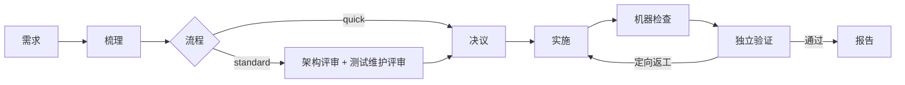
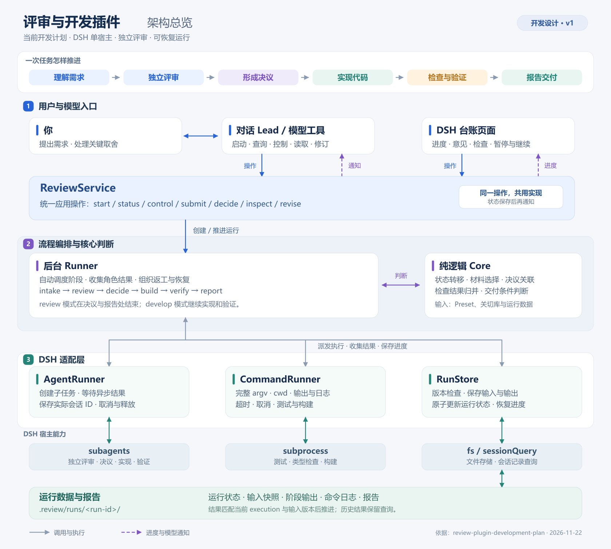

# DSH Team Board

[](https://github.com/teh1592/dsh-team-board/actions/workflows/ci.yml)
[](LICENSE)

面向 **DeepSeek Harness（DSH）** 的评审与开发协作插件，将需求梳理、独立评审、决议、代码实施、机器检查和定向返工连接成可恢复的流程。

Team Board 在团队台账中提供运行管理页面。阶段输出、修改记录、检查结果与日志保存在项目中，方便查看进度、追溯决定，并在中断后继续执行。页面、用户命令和模型工具共用同一套服务。

## 功能

- **两种任务方式**：`review` 形成评审与实施决定，`develop` 继续实施、检查、独立验证及返工。
- **两种流程**：`quick@2` 省略前置双评审；`standard@2` 由架构、测试与维护角色分别提出独立意见。
- **可恢复执行**：支持边界暂停、立即停止、继续、重试和取消，保留中断与旧版本结果。
- **真实机器检查**：执行项目配置的命令，记录退出码、测试数量、日志和代码摘要，识别过期检查结果。
- **定向返工与局部修订**：沿用问题 ID 复验，按影响清单重做受影响任务。
- **运行页面**：查看角色执行、意见、决定、任务、检查、报告与分页日志，处理需要用户选择的问题。
- **历史与用量**：旧任务只读；显式导入时记录来源。用量带会话事件来源，缺失值显示 unknown。



`review` 方式在形成决定后输出报告；图中的实施与验证由 `develop` 方式执行。

## 架构总览



上图为开发设计总览。模块与当前 0.5.0 状态规则见[架构说明](docs/architecture.md)；quick 流程省略图中的前置独立评审。

## 环境

- DeepSeek Harness：已在 **0.2.2-rc.1** 验证。
- Node.js：22 或更新版本，实际宿主联调使用 **24.22.3**。
- 新评审需要 DSH 的 Agent、文件系统、工作目录和 subagents 服务，至少启用一个全新上下文 provider，推荐官方 `spawn`；实施检查还需要 subprocess。
- 会话查询用于中断后的子结果回收和用量来源。旧团队任务板、会议和历史导入另需启用官方 **Agent Teams（智能体团队）**。
- 模型配置沿用 DSH 的设置。本项目不包含模型账号或 API key。

**Team Board 开关与官方 Agent Teams 开关是两项设置。** 只使用新 `review/develop` 流程时可仅启用 subagents；使用完整旧团队功能时还需 Agent Teams。官方组件由 DSH 安装和启用，npm 依赖由插件管理器解析安装。详见[依赖与启用检查](docs/dependencies.md)。

## 安装

### 从 Release 安装

1. 先按[依赖说明](docs/dependencies.md)确认 DSH 的 subagents、全新上下文 `spawn` provider 和所需功能已启用；使用旧团队功能时另外启用官方 Agent Teams。
2. 到 [Releases](https://github.com/teh1592/dsh-team-board/releases) 下载 `local-team-board-0.5.0.tgz`。
3. 在 DSH 中让插件管理工具执行 `install_bundle`，`target` 指向下载包的本地绝对路径。也可以通过 Plugin Manager 的安装入口安装该包。
4. 确认安装结果为 `application: applied`，并检查返回的 warnings。
5. 打开会话中的团队台账页签，启用插件开关，使用上方的评审与开发运行区。

给 DSH 的示例请求：

```text
请通过 plugin_manager 安装 C:/Downloads/local-team-board-0.5.0.tgz，检查安装结果。
```

开关初始关闭。安装插件后，仍由用户决定何时启用。

### 从源码安装

```bash
git clone https://github.com/teh1592/dsh-team-board.git
cd dsh-team-board
npm ci --ignore-scripts
npm run build:client
```

随后在 DSH 中用 `plugin_manager` 安装这个目录的绝对路径。`package.json` 的 `private: true` 用于防止误发 npm，不影响 GitHub 或本地目录安装。

## 开始使用

页面可选择流程、填写需求并启动。让模型启动任务时，可使用 `review_start`：

```json
{
  "requestId": "add-pagination-001",
  "requirement": "为列表接口添加分页，保留旧行为并补充边界测试。",
  "preset": "quick@2",
  "mode": "develop"
}
```

同一次启动重试应复用 `requestId`。返回的 `runId` 用于后续读取和控制。

| 工具 | 用途 |
|---|---|
| `review_start` | 启动评审或开发 |
| `review_status` | 查看当前状态与后续动作 |
| `review_read` | 分页读取意见、决定、检查、报告、日志和用量 |
| `review_control` | 暂停、停止、继续、重试或取消 |
| `review_revise` | 修订需求，按影响清单局部重做 |

用户也可使用命令：

```text
/review start 为列表接口增加分页，保留兼容性并说明验收条件
/review status <runId>
/review read <runId> report
/review pause <runId>
/review resume <runId>
```

简单的 `/review start` 默认启动 `review` 方式。`develop`、检查配置和结构化命令示例见[操作说明](docs/operations.md)。需要用户选择的决定由页面或人工命令提交，模型工具没有代替用户选择的入口。

## 配置机器检查

在需要修改的项目中创建 `.review/config.json`：

```json
{
  "schemaVersion": 1,
  "checks": [{
    "id": "node-tests",
    "kind": "test",
    "phase": "implementation",
    "required": true,
    "argv": ["node", "--test", "--test-reporter", "tap", "test/**/*.test.mjs"],
    "cwd": ".",
    "timeoutMs": 180000,
    "parser": "node-test"
  }],
  "maxReworks": 2
}
```

按项目实际命令调整 `argv`。`develop` 方式需要配置检查；缺少检查时流程会暂停并说明原因。运行数据写入项目的 `.review/runs/`，该目录应保持在 Git 忽略范围内。

## 开发与测试

```bash
npm ci --ignore-scripts
npm test
npm run typecheck
npm run build:client
npm run validate-package
npm pack --ignore-scripts
```

测试脚本会枚举测试文件，避免不同平台对目录或 shell glob 的解释差异。Client 组件与 view-model 修改后需要重新生成并提交 `client.js`。

公开源码发布前，产品套件 **1591/1591** 项测试通过。真实 DSH 联调还覆盖命令、会话索引、分页、版本冲突、取消释放和安装后接口。15 个实际任务试用最终通过 14 项，具体失败、用量缺失和比较条件见[试用结果](docs/practice-results.md)。

## 文档

- [依赖与启用检查](docs/dependencies.md)：subagents、spawn、Agent Teams 与两个开关的区别。
- [操作说明](docs/operations.md)：启动、检查、暂停恢复、修订、历史导入。
- [架构说明](docs/architecture.md)：状态协议、模块和资源生命周期。
- [兼容与验证](docs/compatibility.md)：已验证环境及限制。
- [试用结果](docs/practice-results.md)：single、quick、standard 的采用建议。
- [复用说明](docs/reuse-notes.md)：设计参考和依赖。
- [贡献说明](CONTRIBUTING.md)：本地验证、代码提交和问题报告。
- [更新记录](CHANGELOG.md)：版本变化。

## 许可

[MIT](LICENSE) © 2026 teh1592。第三方依赖保留各自许可。
