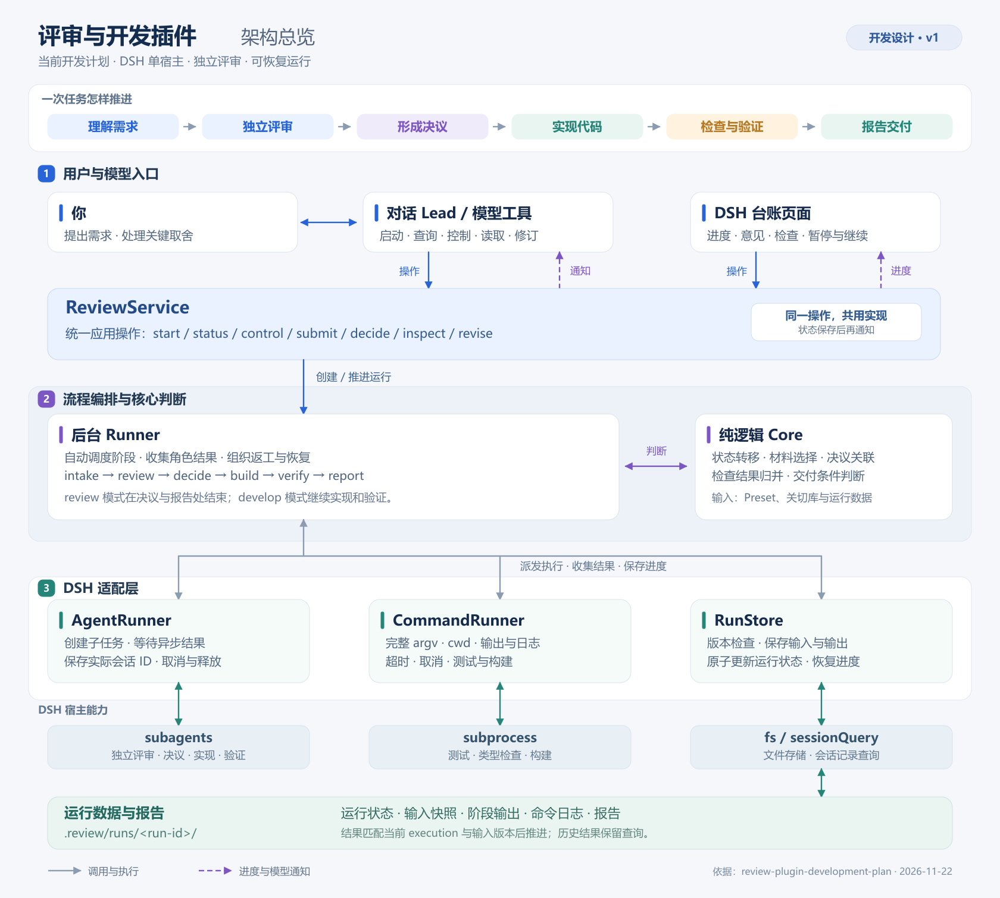

# 架构与状态模型

**简体中文** | [English](en/architecture.md)

DSH Team Board 保留历史任务板与 `@1` preset，并通过独立的 ReviewService 执行 `quick@2`、`standard@2` 评审和开发运行。操作入口见[操作指南](operations.md)，已验证环境及恢复边界见[兼容性说明](compatibility.md)。

## 架构图

此图概括开发设计中的入口、应用服务、编排与宿主适配层。下文说明当前版本的实际阶段、模块与数据规则。

## 流程与模块

`review` 模式形成需求理解、决定、实施要求和报告，不执行代码实施与独立验证。`develop` 模式继续执行单写入者实施、机器检查、独立验证和有界返工。

- `quick@2`：intake → decide → build → verify → report。
- `standard@2`：intake → review → decide → build → verify → report。review 阶段的架构、测试维护两位评审分别使用新会话，并行读取相同需求、材料与 intake 结果。
- 上述两种 preset 在 `review` 模式下均跳过 build、verify。默认 preset 为 `standard@2`。

| 模块 | 职责 |
|---|---|
| [schemas.mjs](../src/review/schemas.mjs)、[types.d.ts](../src/review/types.d.ts) | 中央 schema、状态词汇与类型接口 |
| [state.mjs](../src/review/state.mjs) | operationId 去重、revision 检查、execution 与结果适用性 |
| [preset.mjs](../src/review/preset.mjs)、[inputs.mjs](../src/review/inputs.mjs) | 流程定义、共同材料与角色输入 |
| [runner.mjs](../src/review/runner.mjs) | 顺序推进阶段，在 review 阶段并行执行独立评审 |
| [decisions.mjs](../src/review/decisions.mjs) | 意见来源、重复问题关联、决定与实施任务 |
| [checks.mjs](../src/review/checks.mjs)、[rework.mjs](../src/review/rework.mjs)、[revisions.mjs](../src/review/revisions.mjs) | CheckSpec、问题身份、有界返工与需求影响分析 |
| [review-service.mjs](../host/review-service.mjs) | 保存、启动、提交、控制、用户选择、恢复与通知 |
| [develop-controller.mjs](../host/develop-controller.mjs) | 单 build 写入者、项目检查、独立验证与交付条件 |
| [host/dsh](../host/dsh/) | 公开 subagents、fs、subprocess、Agent、命令与工具适配 |
| [review-plugin.mjs](../host/review-plugin.mjs) | 插件挂载、子会话工具 scope、资源释放与固定项目索引 |
| [report.mjs](../src/review/report.mjs)、[usage.mjs](../src/review/usage.mjs) | 状态、Markdown 报告与有来源的用量统计 |
| [review-panel.mjs](../client/review-panel.mjs)、[view-model.mjs](../src/review/view-model.mjs) | 页面请求生命周期、分页及有界视图 |

## 数据与权限规则

状态、阶段结果信封和项目检查配置使用 `schemaVersion: 1`。阶段结果包含 `executionId`、`requirementRevision`、`decisionRevision`、`inputFingerprint`、`kind` 和对应角色的 `result`，由中央 schema 校验。

`runId` 标识需求运行，`executionId` 标识具体阶段与角色的一次执行。`attempt` 用于业务重试，`operationId` 用于重复投递，`revision` 是 run.json 的版本。阶段从 running 更新到 completed 使用新的 operationId，同一 attempt 保留。

`workStatus` 表达执行是否完成，`reviewDecision` 表达 accept、needs_revision、reject 或 abstain。评审反对方案时，workStatus 仍可为 completed。`checkOutcome` 保存 passed、failed、unknown 或 skipped，结果适用性另以 current、stale 表达。

决定阶段接收完整有效意见、风险、测试场景与用户回答。每项决定保存 findingIds、理由、实际执行身份和检查条件，采纳意见生成实施任务。重复问题保留来源并可合并到同一个决定。待选问题仅由用户通过页面或命令回答；模型的五个公开工具没有 decide。

阶段子会话按角色限制工具 scope：build 可读写文件及执行命令，review、verify 等非 build 角色使用只读工具。限制作用于子会话，保留 `structured_output`、`review_submit`、`run_code` 传输入口，并通过 guard 限制自有非角色工具。根会话与祖先 preset 不被整体改写。`review_submit` 是绑定当前子会话和 execution 的提交工具，不计入根会话的五个公开工具。

每个 execution 固定需求版本、决定版本与输入指纹。结果先保存，身份与当前执行相符后更新状态。需求修订或取消后的结果、同一 execution 的冲突输出保存为 stale。新 decide 输入只选当前版本，历史内容仍可通过 `review_read` 读取。

## 持久化、恢复与资源释放

每个运行固定 projectRoot，runId 由规范项目 targetKey、rootSessionId 和 requestId 生成。同一项目重复请求返回原运行，跨项目请求拥有不同 ID。状态位于 `.review/runs/<runId>/run.json`。不可变输入、输出、命令日志和版本化报告分别保存，报告引用进入状态后才用于读取。报告可以重新生成，运行目录通过 `.review/.gitignore` 排除。

FileRunStore 在进程内按 run 串行提交，文件写入采用宿主 fs 的原子写和版本条件。相同 operationId 与内容返回既有结果，同 ID 改内容或 revision 冲突返回具体错误。

后台 runner 由插件持有，start 保存后立即返回 runId。子任务读取 `activation.result`，完成或取消等待 `activation.dispose`。pause 在阶段边界生效，stop 释放当前句柄并保存 interrupted，cancel 结束运行。卸载先停止派发并保存 paused，再等待子任务、命令和用量读取释放。

重载先读取已保存输出，再通过 sessionQuery observation 检查匹配的 structured_output、review_submit 或最终 JSON 消息，读取后释放 observation。缺少有效结果时标记 interrupted，由用户检查后 retry。重试先等待旧子任务释放，再创建替代 execution。每个 execution 的读取、解析与业务提交独立处理异常，保留诊断和重试入口，其余运行继续加载。

根会话离开运行时或归档后暂停后续派发。根会话恢复时，`rootAvailable` 处理待发通知和可继续工作；用户主动暂停和已中断的执行继续等待用户操作。sessionProjections 从已提交工具、命令结果记录 runId 到 projectRoot 的小索引，使会话切换目录后仍能找到原运行。索引只用于定位，运行状态来自项目文件。

## 开发检查与交付条件

DevelopController 在同一项目协调单 build 写入者。DshProjectFiles 通过公开 fs 读取配置、项目摘要与引用。实施前后记录真实文件摘要和 diff，机器检查绑定命令配置与相关代码指纹；代码或配置变化会使旧结果 stale。

独立验证绑定实际代码摘要，交付前重新核对有效任务、问题和必需检查。恢复时先回收保存结果，再检查实际项目文件；保留部分修改并向 retry 提供完整差异。检查配置、onlyNewFailures 基线、输入范围和返工规则见[操作指南](operations.md)。

build、verify 的 `resolvedFindingIds` 只用于输入 `pendingVerificationFindingIds` 中已修复的 verification 问题。初始 review 意见继续由 decisions、tasks 验收，待复验列表为空时填 `[]`。

## 页面、历史与用量

页面在 `conversation.view/team-board/order40` 中展示评审与开发运行，使用总览、讨论、任务和结果四个页签。开关只读取 enabled，页面不查询 Agent Teams。构建脚本将页面、请求状态、样式和文案与 view-model 内联到 client.js，使用宿主 React 和主题 tokens。

认证 Fetch 路由经过精确根会话与 owner 检查后调用公开 `commands.execute`，与模型工具使用同一 ReviewService。页面用 AbortController 和会话、运行、分区代次避免旧响应覆盖新页面。写入期间锁定按钮，重复投递保持 operationId，revision 冲突保留草稿。

页面列表、详情和运行历史读取不调用 recover/kick。列表遍历当前目录与 session-index 中的项目，并按 rootSessionId 过滤。旧团队工具和历史导入代码保留在原处，新页面不调用。

usage 从子会话已提交的 assistant/message.data.usage 汇总 token，并保留来源事件序号；时间和返工次数来自已保存状态。缺失字段保留 null/unknown。实际试用的完整性和比较限制见[试用结果](practice-results.md)。
