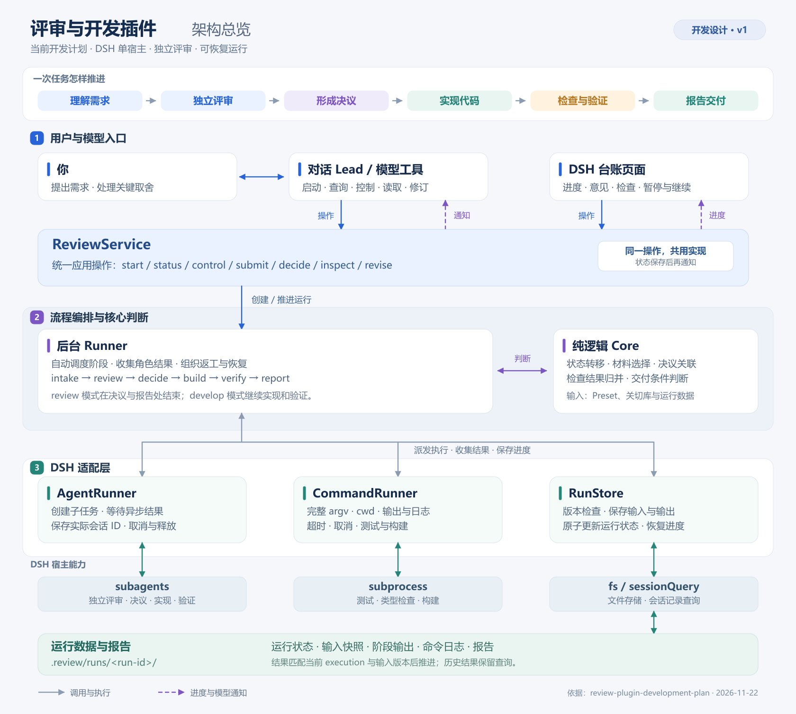

# Architecture and State Model

[中文原文](../architecture.md) | [English README](../../README.en.md)

DSH Team Board retains the legacy task board and `@1` presets, while a separate ReviewService runs `quick@2` and `standard@2` review and development workflows. See the [operations guide](operations.md) for entry points, and [compatibility notes](compatibility.md) for verified environments and recovery boundaries.

## Architecture Diagram

This diagram, in Chinese, summarizes the entry points, application services, orchestration, and host adapters in the development design. The sections below describe the actual stages, modules, and data rules in the current version.

## Workflows and Modules

`review` mode produces a requirements interpretation, decisions, implementation requirements, and a report. It does not implement code or perform independent verification. `develop` mode continues with single-writer implementation, machine checks, independent verification, and bounded rework.

- `quick@2`: intake → decide → build → verify → report.
- `standard@2`: intake → review → decide → build → verify → report. In the review stage, the architecture reviewer and the testing/maintenance reviewer each use a fresh session to read the same requirements, materials, and intake results in parallel.
- Both presets skip build and verify in `review` mode. The default preset is `standard@2`.

| Module | Responsibility |
|---|---|
| [schemas.mjs](../../src/review/schemas.mjs), [types.d.ts](../../src/review/types.d.ts) | Central schemas, state vocabulary, and type interfaces |
| [state.mjs](../../src/review/state.mjs) | operationId deduplication, revision checks, executions, and result applicability |
| [preset.mjs](../../src/review/preset.mjs), [inputs.mjs](../../src/review/inputs.mjs) | Workflow definitions, shared materials, and role inputs |
| [runner.mjs](../../src/review/runner.mjs) | Sequential stage progression, with parallel independent reviewers during the review stage |
| [decisions.mjs](../../src/review/decisions.mjs) | Finding provenance, duplicate-issue associations, decisions, and implementation tasks |
| [checks.mjs](../../src/review/checks.mjs), [rework.mjs](../../src/review/rework.mjs), [revisions.mjs](../../src/review/revisions.mjs) | CheckSpec, issue identity, bounded rework, and requirements impact analysis |
| [review-service.mjs](../../host/review-service.mjs) | Persistence, start, submission, control, user choices, recovery, and notifications |
| [develop-controller.mjs](../../host/develop-controller.mjs) | A single build writer, project checks, independent verification, and delivery conditions |
| [host/dsh](../../host/dsh/) | Adapters for public subagents, fs, subprocess, Agent, commands, and tools |
| [review-plugin.mjs](../../host/review-plugin.mjs) | Plugin mounting, child-session tool scopes, resource release, and the fixed-project index |
| [report.mjs](../../src/review/report.mjs), [usage.mjs](../../src/review/usage.mjs) | Status, Markdown reports, and usage statistics with provenance |
| [review-panel.mjs](../../client/review-panel.mjs), [view-model.mjs](../../src/review/view-model.mjs) | Page request lifecycle, pagination, and bounded views |

## Data and Permission Rules

State, stage-result envelopes, and project check configuration use `schemaVersion: 1`. Stage results contain `executionId`, `requirementRevision`, `decisionRevision`, `inputFingerprint`, `kind`, and the corresponding role's `result`, validated by the central schema.

`runId` identifies a requirements run; `executionId` identifies one execution of a specific stage and role. `attempt` tracks business-level retries, `operationId` handles duplicate delivery, and `revision` is the version of run.json. Updating a stage from running to completed uses a new operationId while retaining the same attempt.

`workStatus` indicates whether execution has completed, while `reviewDecision` expresses accept, needs_revision, reject, or abstain. A reviewer can oppose a proposal while still having workStatus completed. `checkOutcome` stores passed, failed, unknown, or skipped; result applicability is represented separately as current or stale.

The decision stage receives all valid findings, risks, test scenarios, and user answers. Each decision stores findingIds, its rationale, the actual execution identity, and check conditions; accepted findings generate implementation tasks. Duplicate issues retain their provenance and may be merged into a single decision. Only users can answer pending questions, through the page or commands; the model's five public tools do not include decide.

Stage child sessions have role-specific tool scopes: build can read and write files and execute commands, while non-build roles such as review and verify use read-only tools. Restrictions apply to child sessions, preserve the `structured_output`, `review_submit`, and `run_code` transport entry points, and use a guard to restrict tools owned by the session that are outside the role's permissions. The root session and ancestor presets are not rewritten wholesale. `review_submit` is a submission tool bound to the current child session and execution; it is not one of the root session's five public tools.

Each execution fixes the requirements version, decision version, and input fingerprint. Results are saved first; state is updated only after their identity matches the current execution. Results received after a requirements revision or cancellation, and conflicting outputs for the same execution, are saved as stale. New decide inputs use only the current version; historical content remains readable through `review_read`.

## Persistence, Recovery, and Resource Release

Each run has a fixed projectRoot. Its runId is generated from the canonical project targetKey, rootSessionId, and requestId. A duplicate request in the same project returns the original run; requests across projects have different IDs. State is stored at `.review/runs/<runId>/run.json`. Immutable inputs, outputs, command logs, and versioned reports are stored separately; a report is used for reads only after its reference has been recorded in state. Reports can be regenerated, and run directories are excluded through `.review/.gitignore`.

FileRunStore serializes commits per run within the process, using the host fs service's atomic writes and version conditions. The same operationId and content return the existing result; changed content under the same ID or a revision conflict returns a specific error.

The plugin owns the background runner, and start returns runId immediately after saving. Child tasks read `activation.result` and await `activation.dispose` on completion or cancellation. pause takes effect at a stage boundary; stop releases the current handle and saves interrupted; cancel ends the run. Unloading first stops dispatch and saves paused, then waits for child tasks, commands, and usage reads to release their resources.

Reloading first reads saved outputs, then uses a sessionQuery observation to check for matching structured_output, review_submit, or final JSON messages, releasing the observation after reading. If no valid result is available, the execution is marked interrupted for the user to inspect before retry. A retry waits for the old child task to release its resources before creating a replacement execution. Reading, parsing, and business-level submission handle errors independently for each execution, preserving diagnostics and a retry entry point while other runs continue loading.

Further dispatch pauses when the root session leaves the runtime or is archived. When the root session becomes available again, `rootAvailable` handles pending notifications and work that can continue; user-paused runs and interrupted executions still wait for user action. sessionProjections records a small runId-to-projectRoot index from committed tool and command results, allowing the original run to be located after the session changes directories. The index is only for locating runs; run state comes from project files.

## Development Checks and Delivery Conditions

DevelopController coordinates a single build writer within a project. DshProjectFiles reads configuration, project digests, and references through the public fs service. Actual file digests and diffs are recorded before and after implementation. Machine checks are bound to command configuration and relevant code fingerprints; code or configuration changes make old results stale.

Independent verification is bound to the actual code digest. Before delivery, valid tasks, findings, and required checks are rechecked. Recovery first retrieves saved results, then checks actual project files; partial changes are retained, and retry receives the complete diff. See the [operations guide](operations.md) for check configuration, onlyNewFailures baselines, input scopes, and rework rules.

For build and verify, `resolvedFindingIds` is only for fixed verification findings included in the input `pendingVerificationFindingIds`. Initial review findings continue to be accepted through decisions and tasks; use `[]` when the pending re-verification list is empty.

## Page, History, and Usage

The page displays review and development runs in `conversation.view/team-board/order40`, with Overview, Discussion, Tasks, and Results tabs. The switch reads only enabled; the page does not query Agent Teams. The build script inlines the page, request state, styles, messages, and view-model into client.js, using the host's React and theme tokens.

The authenticated Fetch route calls the public `commands.execute` after exact root-session and owner checks, using the same ReviewService as model tools. The page uses AbortController and session, run, and section generations to prevent old responses from overwriting a newer view. Buttons are locked during writes, repeated deliveries retain operationId, and revision conflicts preserve drafts.

Page list, detail, and run-history reads do not call recover/kick. Listing traverses the current directory and projects in session-index, filtering by rootSessionId. Legacy team tools and import code remain in place, but the new page does not call them.

usage aggregates tokens from child sessions' committed assistant/message.data.usage and retains source event sequence numbers; timing and rework counts come from saved state. Missing fields remain null/unknown. See [trial results](practice-results.md) for completeness and comparison limits in actual trials.
